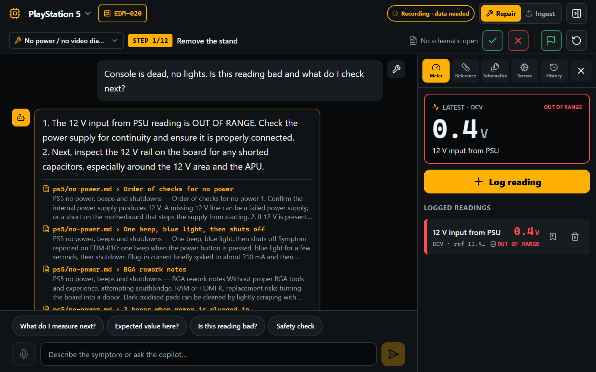
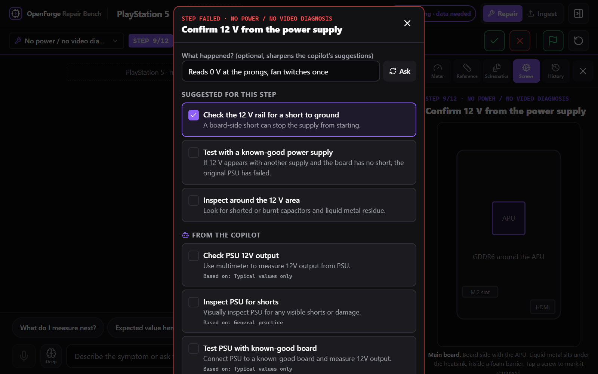
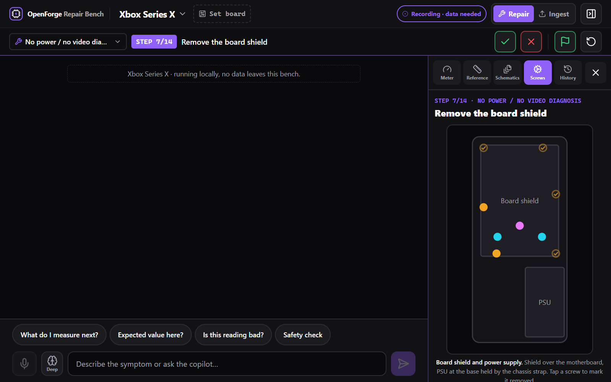
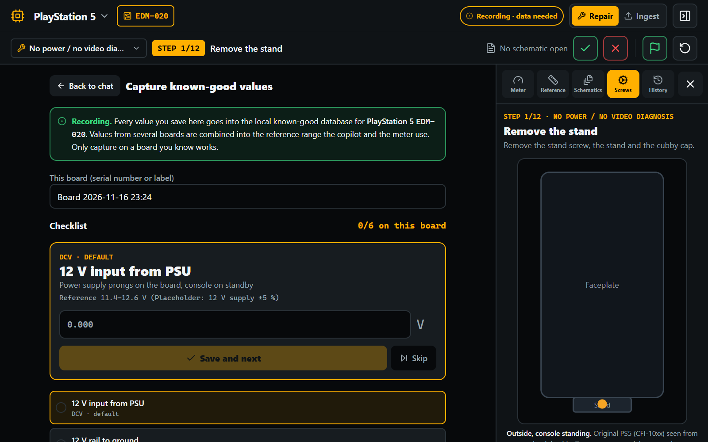
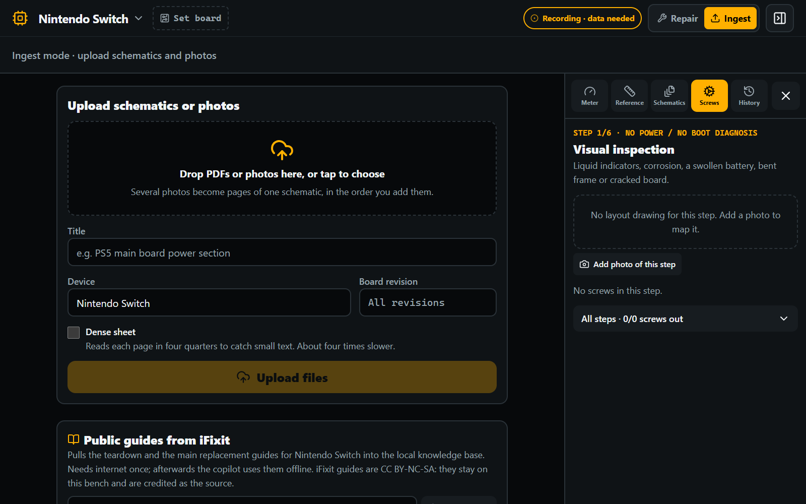

# OpenForge Edge 🛠️
**An offline AI copilot for the hardware repair bench, built on AMD Lemonade**

[](LICENSE)
[](https://lemonade-server.ai)
[](https://nextjs.org/)
[](https://fastapi.tiangolo.com/)
[](https://langchain-ai.github.io/langgraph/)

OpenForge Edge is an open-source copilot for electronics repair technicians, micro-soldering shops and the Right-to-Repair community. It walks a technician through a repair step by step, reads their meter readings, searches the manuals and schematics they have loaded, suggests what to try when a step fails, and learns from every finished job. Everything runs on the bench machine: no cloud, no API keys, and customer devices, licensed schematics and repair data never leave the shop.

| Copilot answer with sources and a live meter reading | When a step fails, new steps are suggested |
|---|---|
|  |  |

| Guided repairs with screw maps | Known-good capture | Schematic and guide ingest |
|---|---|---|
|  |  |  |

> 🎥 **Demo video:** coming soon.

---

## 🍋 AMD Lemonade Developer Challenge

OpenForge Edge is entered in the [AMD Lemonade Developer Challenge](https://lemonade-server.ai). It shows Lemonade powering a complete, multi-agent, multimodal application rather than a chat window: one local Lemonade server provides chat, vision and embeddings, and the app manages which models are loaded so it fits on a laptop.

### Why a repair bench needs local AI
*   **Privacy:** phones, laptops and consoles on the bench hold customers' personal data, and many shops are contractually barred from uploading it.
*   **Licensed data:** schematics and boardview data from paid tools are licensed for the shop's own use; sending them to a cloud API would break that licence.
*   **No dependable internet:** benches are often in back rooms, basements and on the road. The copilot has to work with the network cable unplugged.
*   **Cost:** a busy bench asks hundreds of questions a day. Local inference makes that free.

### How Lemonade is used

| Capability | Lemonade feature | Where |
|---|---|---|
| Streaming copilot answers, triage routing, next-step suggestions | OpenAI-compatible `/api/v1/chat/completions` with streaming; `enable_thinking` turned off for Qwen3 so answers start immediately | [`backend/llm.py`](backend/llm.py) |
| Reading schematic PDFs and phone photos of schematics | Vision-language GGUF models (`Qwen2.5-VL-7B-Instruct-GGUF`, `Gemma-3-4b-it-GGUF`) with image inputs | [`backend/vision.py`](backend/vision.py) |
| Searching manuals, schematics, iFixit guides and past repairs | `/api/v1/embeddings` with `nomic-embed-text-v1-GGUF` | [`backend/knowledge.py`](backend/knowledge.py) |
| Repair / Ingest switch: only one large model in memory at a time | `/api/v1/load` and `/api/v1/unload` | [`backend/mode.py`](backend/mode.py) |
| One-command setup | `lemonade pull`, a ready-made `.env.lemonade.example`, setup scripts for Windows and Linux | [`scripts/setup-lemonade.ps1`](scripts/setup-lemonade.ps1), [`.env.lemonade.example`](.env.lemonade.example) |

Switching the whole stack to Lemonade is one file: copy `.env.lemonade.example` to `.env`. See [AMD Lemonade Integration](#-amd-lemonade-integration) for setup, model choices per AMD platform, and how each piece works.

### What the judges asked for

| Criterion | What OpenForge Edge brings |
|---|---|
| **Community impact** | MIT licensed. A complete reference app for building a real Lemonade-backed product: LangChain + Lemonade provider setup, vision ingest, embeddings with a mismatch guard, model load/unload management, Docker networking notes for Windows, WSL2 and Linux. Every feature is documented in this README, with [contribution guidelines](CONTRIBUTING.md) for device profiles and sourced repair notes. Built for an underserved community: independent repair technicians. |
| **Technical depth** | LangGraph multi-agent routing (triage → retrieval → answer), retrieval across manuals, vision-read schematics, iFixit guides and the shop's own repair history, a value-coverage check that answers "not in the knowledge base yet" instead of inventing a voltage, automatic promotion of recurring faults from repair history, board-revision filtering, streaming over NDJSON, backups and restore. |
| **Creativity** | A bench-first interface for gloved hands: large touch targets, a live multimeter HUD, 2D screw maps that show only the screws for the current step, photo-based screw mapping, a "step failed" panel that proposes new diagnostic steps, and a known-good capture mode that turns every working board into reference data. |

### Status

*   Developed and used daily on an **NVIDIA RTX 2060 6 GB laptop with Ollama**. Ollama also exposes an OpenAI-compatible API, and the Lemonade chat code path was exercised through it.
*   The Lemonade configuration, setup scripts, vision path and load/unload calls are implemented from Lemonade's documentation but **have not yet run on AMD hardware**: the author does not have an AMD machine yet.
*   Closing that gap is the first job for a Ryzen AI laptop, following the plan below.

### 📊 Performance evaluation plan

The evaluation planned for an AMD Ryzen™ AI Max+ 395 (Strix Halo) laptop, with results, raw data and scripts to be published in this repository:

| | |
|---|---|
| **Configurations** | Lemonade llama.cpp on the Radeon iGPU with ROCm and with Vulkan; Lemonade NPU/Hybrid models where supported; baseline: Ollama on the RTX 2060 laptop used for development |
| **Models** | Qwen3-8B and Qwen3-4B-Instruct for chat, a larger MoE model such as Qwen3-30B-A3B that the unified memory makes possible, Qwen2.5-VL-7B for vision, nomic-embed-text for embeddings |
| **Speed** | Time to first token, tokens per second, end-to-end answer time, cold model-load time, Repair ↔ Ingest switch time, seconds per schematic page |
| **Quality** | A fixed set of real bench questions per device with known answers, scored as correct, correctly "not in the knowledge base", or wrong; with special attention to invented voltages and part numbers |
| **Efficiency** | Package power and battery drain per 100 questions, memory use per configuration |
| **Method** | Same questions, prompts and knowledge base for every configuration; one warm-up run, then three measured runs; median reported with the spread |

With up to 128 GB of unified memory, Strix Halo can also keep the chat, vision and embedding models loaded at the same time, so the Repair / Ingest switch becomes optional. Measuring whether larger local models measurably reduce wrong answers at the bench is the most interesting result for the local-AI community.

---

## 🚀 Key Features

*   **Zero-Trust Edge Inference:** Runs 100% offline using local LLMs, ensuring customer data privacy and eliminating cloud compute costs.
*   **AMD Lemonade Ready:** Switch the whole AI stack (chat, vision and embeddings) to Lemonade with `.env.lemonade.example` and a setup script, including model load/unload for the Repair / Ingest switch. Targets Ryzen AI NPU + iGPU (Hybrid) and Radeon GPUs with ROCm or Vulkan; Ollama (`qwen2.5:7b`) remains available for other hardware.
*   **Streaming Bench Chat:** Large, high-contrast chat built for use mid-repair. Answers stream in as they are generated, with live agent status ("Triaging issue…", "Searching schematics…") and cited manual excerpts.
*   **Deep Thinking Toggle:** A **Deep** button next to the chat box sends the next questions to a stronger model (`qwen3:8b` by default). About 10 seconds per answer normally, 30–50 seconds with Deep on, for hard faults that need a more thorough answer.
*   **Multimeter HUD & Diode Testing:** Log readings from any meter with large touch targets (test point, mode, value, optional expected range). Readings are flagged in/out of range and sent to the copilot, so you can ask "Is this reading bad?" or "What should I check next?".
*   **Device Profiles:** Full profiles (screw maps, iFixit-sourced notes) for PlayStation 5 and Xbox Series X, starter profiles for PlayStation 4, Xbox Series S, Xbox One, Nintendo Switch and Switch 2, iPhone, Google Pixel, Samsung Galaxy S, iPad, Android tablets, MacBook and Windows laptops, plus any other device by name. Switching devices keeps a separate session for each, so you can flip between benches and pick up where you left off.
*   **Repair Procedures and 2D Screw Maps:** Choose the repair (no-power diagnosis, fan cleaning, APU repaste, optical drive, SSD access). Each step shows a 2D layout of that stage with only the screws that step removes, colour-coded by length. Tap screws as they come out; the next step unlocks when they're all out.
*   **Known-Good Capture:** A guided checklist for measuring a working board, test point by test point. Every value is saved to the local database, and values from several boards are combined into the reference range. Import your own test point lists and expected values (CSV or JSON) from your boardview software.
*   **Step Photos:** Photograph each teardown stage and tap to place its screws on the photo, replacing the approximate drawing with an exact map.
*   **Automatic Recurring Patterns:** When three or more fixed repairs share a similar symptom and root cause, they are promoted to a recurring pattern. The copilot names it first on matching symptoms and the failed-step panel suggests it.
*   **Placeholders and iFixit Import:** New devices start with clearly-marked typical values from interface standards (USB, HDMI, Li-ion, 12 V supplies) that your first captures replace, and can pull their public iFixit guides into the local knowledge base in one click.
*   **Backups:** One command backs up everything the bench has learned; another restores it and rebuilds the search index.
*   **Data Coverage Prompts:** When a device or board revision has little or no saved data, the Bench UI says so, asks for known-good captures and finished repairs, and shows a "Recording" indicator so the tech knows what is being saved.
*   **Failed-Step Suggestions:** When a step fails (the red ✕), the copilot suggests what to do next: built-in follow-ups for that step plus suggestions drawn from the manuals, schematics, readings and past repairs. Pick the ones you want and they are inserted into the repair.
*   **Local RAG for Repair Manuals:** Ingest schematic PDFs, Markdown notes and JSON measurement files into ChromaDB with local `nomic-embed-text` embeddings. Answers cite the excerpts they used, and questions asking for a voltage, reading or resistance the knowledge base doesn't contain get "not in the knowledge base yet" instead of a guess.
*   **Schematic Vision Ingest:** Upload schematic PDFs or phone photos of schematics in the Bench UI. A local vision model (`qwen3-vl:4b-instruct`) reads every page into rails, components, connectors and test points, which become searchable. Each page can be checked and corrected against the original image.
*   **Repair / Ingest Mode Toggle:** One switch in the header swaps the GPU between the chat model (diagnosing boards) and the vision model (reading schematics), so both fit on a 6 GB card.
*   **Schematic Viewer:** Answers that come from a schematic link straight to the cited page, with zoom and page navigation.
*   **Board Revisions:** Set the board revision (e.g. `EDM-020`) for the session; schematics, reference values and answers are filtered to that revision plus anything marked for all revisions.
*   **Known-Good Reference Values:** Save expected readings per test point and board revision, typed in or saved from a reading on a working board in one tap. New readings are checked against them automatically, and the copilot trusts them over the manuals.
*   **Repair History:** Finish a job with its outcome, root cause and fix. Past repairs are stored in MongoDB, and the copilot brings up matching ones on later jobs ("a previous board with this symptom had…").

> **Current status:** the knowledge base ships with sourced notes for the PS5 (board revisions, chips identified in iFixit's teardown, no-video and no-power diagnosis, teardown and liquid metal service) and the Xbox Series X (board and chip overview, full disassembly with screw sizes, from iFixit). Add your own schematics, reference values and repair history to grow it. Readings are logged by hand in the HUD; live USB/Bluetooth meter input, boardview files and voice input are planned.

---

## 🏗️ Architecture & Tech Stack

OpenForge Edge uses a decoupled, containerized architecture optimized for local execution via WSL2 and Docker. The LLM engine runs on the host so it can use the local GPU/NPU directly.

```
 Browser ──▶ frontend (Next.js :3000)
    │
    └──────▶ backend (FastAPI :8000)
                 │
                 ├─ Repair mode: LangGraph  triage ─▶ schematic_rag ─▶ respond ──▶ chat model
                 │                                     (manuals, schematics,
                 │                                      reference values, past repairs)
                 ├─ Ingest mode: upload ─▶ page images ─▶ vision model ─▶ chunks
                 │
                 ├──▶ chromadb (:8001)   manual + schematic chunks, repair history
                 ├──▶ mongodb (:27017)   schematics, reference values, repairs, mode
                 └──▶ Ollama / Lemonade on the host (chat, vision, embeddings)
```

### Frontend (The Bench UI)
*   **Framework:** Next.js 15 & React 19
*   **Styling:** Tailwind CSS 4
*   **State Management:** Zustand (session persisted in the browser)
*   **Icons:** Lucide React

### Backend (Multi-Agent Routing)
*   **API:** FastAPI (running via Uvicorn)
*   **Agent Framework:** LangGraph. A `TriageAgent` identifies the issue and routes to specialist agents (currently `SchematicRAGAgent`, which pulls manual and schematic excerpts, known-good values and past repairs), then a responder writes the final answer.
*   **Vision pipeline:** PDFs are rendered with `pypdfium2` and photos normalised with Pillow (HEIC supported). A background worker sends each page to the vision model while Ingest mode is on.
*   **Local AI Engine:** AMD Lemonade (`LLM_PROVIDER=lemonade`, via the OpenAI-compatible API) or Ollama (`ChatOllama`). Embeddings use the same engine (`EMBED_PROVIDER`).

### Data Layer
*   **Document Store:** MongoDB 8 (schematic jobs and page text, reference values, repair history, current mode)
*   **Uploads:** page images in the `openforge_uploads_data` Docker volume
*   **Vector Database:** ChromaDB

### Project Structure
```
├── app/                    Next.js layout, page, global styles
├── components/             ChatPanel, HudSidebar, HudPanels, ScrewMap, DevicePicker, SessionHeader, ModeToggle,
│                           IngestPanel, SchematicViewer, FinishRepairDialog
├── lib/copilot.ts          Streaming chat client
├── lib/api.ts              REST client (mode, schematics, reference values, repairs)
├── lib/devices.ts          Device profiles: procedures, steps, screw groups, 2D layouts
├── store/useRepairStore.ts Zustand repair-session store
├── backend/
│   ├── main.py             FastAPI app and endpoints
│   ├── graph.py            LangGraph wiring
│   ├── agents/             triage, schematic_rag, responder + registry
│   ├── knowledge.py        Embeddings, device and revision filters, ChromaDB search
│   ├── ingest.py           Loads data/manuals into ChromaDB
│   ├── schematics.py       Upload, page rendering, vision worker, viewer endpoints
│   ├── vision.py           Vision model client (Ollama or OpenAI-compatible)
│   ├── mode.py             Repair / Ingest switch and model loading
│   ├── reference.py        Known-good reference values
│   ├── history.py          Repair history
│   ├── suggest.py          Next-step suggestions after a failed step
│   ├── capture.py          Known-good capture, test point import, coverage, bench reading log
│   ├── photos.py           Step photos and screw marker positions
│   ├── starter.py          Starting test points and placeholder values per device
│   ├── ifixit.py           Pulls public iFixit guides into the knowledge base
│   ├── db.py               MongoDB connection
│   ├── llm.py, config.py, state.py
│   └── requirements.txt
├── data/manuals/<device>/  Knowledge base source files (ps5/, xbox-series-x/)
├── scripts/
│   ├── setup-lemonade.ps1  Lemonade setup for Windows
│   ├── setup-lemonade.sh   Lemonade setup for Linux
│   ├── offline-check.ps1   Checks everything is local before going offline
│   ├── backup.ps1          Backs up MongoDB, uploads and data/manuals
│   └── restore.ps1         Restores a backup and rebuilds the search index
├── Dockerfile.frontend
├── Dockerfile.backend
├── docker-compose.yml
├── .env.example            Ollama configuration (default)
└── .env.lemonade.example   AMD Lemonade configuration
```

---

## 🛠️ Getting Started

### Prerequisites
*   Windows 11 with WSL2 enabled (or a native Linux environment)
*   [Docker Desktop](https://www.docker.com/products/docker-desktop/) with Docker Compose (WSL2 backend on Windows)
*   A local AI engine on the host: [AMD Lemonade](https://lemonade-server.ai) (see [AMD Lemonade Integration](#-amd-lemonade-integration)) or [Ollama](https://ollama.com/download). The steps below use Ollama; the Lemonade section replaces steps 2 and 3.
*   ~8 GB free disk space (models + Docker images); 16 GB RAM recommended for 7B models
*   A GPU with 6 GB+ VRAM is strongly recommended (developed on an RTX 2060 6 GB: answers start streaming in a few seconds). CPU-only laptops work but are several times slower.
*   For local development only: Node.js 20+ and Python 3.11+

### 1. Clone the repository
```bash
git clone https://github.com/JP21-dev/OpenForge-Edge.git
cd OpenForge-Edge
```

### 2. Install the local models
Start Ollama, then pull the chat model (~4.7 GB), the embedding model (~274 MB) and the vision model for reading schematics (~3.3 GB):
```bash
ollama pull qwen2.5:7b
```
```bash
ollama pull nomic-embed-text
```
```bash
ollama pull qwen3-vl:4b-instruct
```
Optionally, pull the model used by the **Deep** button (~5.2 GB):
```bash
ollama pull qwen3:8b
```
Use the `-instruct` tag: the plain `qwen3-vl:4b` tag is the reasoning variant, which thinks for thousands of tokens before transcribing a page.
Check that Ollama is serving it:
```bash
ollama list
```

> **Windows:** if `ollama` isn't found, use the full path: `%LOCALAPPDATA%\Programs\Ollama\ollama.exe`.
>
> **Lower-spec machines:** `llama3.2:3b` (~2 GB) is faster but less accurate. Pull it and set `LLM_MODEL=llama3.2:3b` in `.env`.

### 3. Configure environment variables
Copy the example file:
```bash
cp .env.example .env
```
(PowerShell: `Copy-Item .env.example .env`)

Then edit `.env`. At minimum, **change `MONGO_ROOT_PASSWORD`** before the first launch. MongoDB only applies these credentials when its data volume is first created.

*(Note: Ensure all proprietary service manuals or specific enterprise network configs are sanitized from your `.env` before running.)*

### 4. Launch the stack
Make sure Docker Desktop is running, then build and start all four services:
```bash
docker compose up -d --build
```
The first build takes several minutes (the backend installs ChromaDB and LangChain).

| Service | URL | Notes |
|---|---|---|
| Bench UI | http://localhost:3000 | Open this in your browser |
| Backend API | http://localhost:8000 | Interactive docs at `/docs` |
| ChromaDB | http://localhost:8001 | Vector store |
| MongoDB | `mongodb://localhost:27017` | Credentials from `.env` |

All ports bind to `127.0.0.1`, so the databases are never exposed to the shop network. The browser only talks to the Bench UI: requests to `/api` are forwarded by the frontend to the backend over Docker's internal network. To use the bench from other devices, see [Remote Access with Tailscale](#-remote-access-with-tailscale).

### 5. Load the knowledge base
Embed everything in `data/manuals/` into ChromaDB (takes a few seconds for the bundled PS5 notes):
```bash
docker compose exec backend python ingest.py
```
Run it again whenever you add or edit files. Use `--reset` to rebuild the collection from scratch. See [Knowledge Base](#-knowledge-base) for supported formats.

### 6. Verify everything is connected
```bash
curl http://localhost:8000/api/health
```
A healthy stack returns:
```json
{"status":"ok","model":"qwen2.5:7b","provider":"ollama","vision_model":"qwen3-vl:4b-instruct","mode":"repair","llm_base_url":"http://host.docker.internal:11434","embedding":"ollama:nomic-embed-text","knowledge_chunks":14,"knowledge_built_with":"ollama:nomic-embed-text","services":{"chromadb":"ok","mongodb":"ok"}}
```
`knowledge_chunks` should be above 0. Then open http://localhost:3000 and ask the copilot something, e.g. *"PS5 beeps 3 times when I plug it in"*.

> **Before a demo:** send one question first. The model loads into RAM on its first request, and `LLM_KEEP_ALIVE` (default `30m`) keeps it there between questions.

### Stopping and resetting
Stop the stack (data is kept):
```bash
docker compose down
```
Stop and **delete all stored data** (ChromaDB vectors, MongoDB, uploaded schematics, reference values and repair history):
```bash
docker compose down -v
```
After pulling new code, rebuild:
```bash
docker compose up -d --build
```

---

## 📚 Knowledge Base

Source files live in `data/manuals/`, one subfolder per device family. The folder name becomes the `device` tag used to filter searches:
```
data/manuals/
└── ps5/
    ├── overview.md
    ├── no-power.md
    ├── no-video-hdmi.md
    ├── teardown-liquid-metal.md
    └── EDM-020-service-manual.pdf    (your own files)
```
The backend container mounts this folder read-only at `/app/manuals`.

**Supported formats**
*   **Markdown / text (`.md`, `.txt`):** split by `#`/`##`/`###` headings into chunks. Optional front matter adds metadata:
    ```
    ---
    title: PS5 no video / no HDMI signal
    device: ps5
    board: EDM-020
    type: procedure
    reliability: verified on bench
    url: https://example.com/source
    ---
    ```
*   **PDF (`.pdf`):** text is extracted page by page; answers cite the page number. Scanned PDFs without a text layer have nothing to extract (OCR is planned).
*   **JSON measurements (`.json`):** one chunk per entry, ideal for boardview readings from a known-good board:
    ```json
    {
      "title": "EDM-020 known-good readings",
      "board": "EDM-020",
      "entries": [
        { "name": "<rail or test point>", "kind": "voltage", "value": "<measured value>", "location": "<designator>", "notes": "measured on known-good board" }
      ]
    }
    ```

**Device detection:** a question is searched within a device's documents when the session's device name or the question mentions it (PS5: "PS5", "PlayStation 5", "CFI-1…", "EDM-0…"; Xbox Series X: "Xbox Series X", "Series X", "XSX"; and so on for every built-in device). The session's device always wins over words in the question, so "dead pixels" on an iPhone stays on the iPhone. Add aliases for new devices in `DEVICE_ALIASES` in `backend/knowledge.py`; the key must match the device's folder name in `data/manuals/`.

---

## 🔩 Devices, Repairs and Screw Maps

Tap the device name in the header to switch between the built-in profiles or type any other device. Each device keeps its own session (chat, readings, board revision, repair and screw progress), and switching back restores it.

The wrench chip next to the step counter picks the repair. Each repair only includes the steps it needs: fan cleaning on an Xbox Series X is three steps and five screws, while a no-power diagnosis opens the console down to the board first.

The HUD's **Screws** tab follows the current step:
*   A 2D drawing of that stage of the device, with a marker for every screw the step removes, colour-coded by group.
*   A list of the same screws with head type, length and count. Tap a marker or a row to mark screws removed.
*   When every screw in the step is out, **All out: next step** advances the procedure. **All steps** lists the whole repair and lets you jump to any step.

### When a step fails
Press the red **✕** in the header instead of the green check. A **Step failed** panel opens with:
*   **Suggested for this step:** built-in follow-ups written into the device profile, for example a short-to-ground check and a known-good PSU swap when 12 V is missing, or screw-extraction tips on teardown steps.
*   **From the copilot:** up to four steps generated from the failed step, an optional note ("12 V reads 0, fan twitches once"), logged readings, reference values, the knowledge base and past repairs. Each one says which source it came from. Type a note and press **Ask** to refine them. Needs Repair mode.

Tick the steps you want and press **Add steps and continue**: the failed step is marked ✕, the chosen steps are inserted right after it (tagged *added* in the step list), and a line in the chat records what failed and what was added. **Mark failed only** skips ahead without adding anything.

Screw counts and lengths come from iFixit's guides, linked in the panel. The drawings are simplified and positions are approximate (iFixit's photos are not bundled, so the app stays offline): match screws by colour and length.

| Device | Profile | Repairs |
|---|---|---|
| PlayStation 5 (original) | Full: screw map, iFixit notes | No power / no video, fan cleaning, APU liquid metal service |
| Xbox Series X | Full: screw map, iFixit notes | No power / no video, fan cleaning, optical drive, internal SSD |
| PlayStation 4, Xbox Series S, Xbox One | Starter | No power / no video, cleaning and overheating |
| Nintendo Switch, Switch 2 | Starter | No power / no boot, no video in the dock, battery, charging port |
| iPhone, Google Pixel, Samsung Galaxy S, iPad, Android tablet | Starter | No power / no boot, battery, charging port |
| MacBook, Windows laptop | Starter | No power, no display, battery |
| Any other device | Generic | General diagnosis steps |

**Starter profiles** have generic, model-independent procedures and no screw drawings. Take a photo at each teardown step and place the screws on it to build an exact map. They are marked "starter" in the device menu.

**Adding a device:** add a profile to `DEVICES` in `lib/devices.ts` (views drawn on a 100 × 160 grid, screw groups with positions, procedures whose steps list screw group ids and optional `onFail` suggestions), add its aliases to `DEVICE_ALIASES`, and put its notes in `data/manuals/<device-id>/`.

**Private files:** PDFs under `data/manuals/` and any `data/manuals/**/private/` folder are git-ignored so proprietary schematics are never pushed. Markdown and JSON files are committed; keep only content you are allowed to share in them.

**Accuracy:** only add values you trust (service manuals, boardview, measurements from known-good boards). The copilot will repeat whatever is in the knowledge base.

**Board revisions:** add `board_rev: EDM-020` to a file's front matter to limit it to one revision. Files without it apply to every revision.

---

## 📐 Schematics, Reference Values and Repair History

### Repair and Ingest modes
The header has a **Repair / Ingest** switch. Only one large model fits in a 6 GB GPU at a time, and you won't be reading schematics while you're probing a board, so the switch swaps them:

| Mode | Model loaded | What you can do |
|---|---|---|
| Repair | Chat model (`LLM_MODEL`) | Chat with the copilot, log readings, view schematics |
| Ingest | Vision model (`VISION_MODEL`) | Upload schematics and photos; the queue is read page by page |

Switching unloads the current model from the GPU and preloads the other (Ollama; with Lemonade the backend calls its load/unload endpoints). The chat is disabled in Ingest mode, and queued pages wait until Ingest mode is on. The mode is stored in MongoDB, so it survives restarts.

### Uploading schematics
1. Switch to **Ingest**.
2. Drop PDFs or photos into the upload box. Several photos uploaded together become the pages of one schematic, in the order added.
3. Enter a title, the device and the board revision (leave the revision empty if the sheet covers every revision). Tick **Dense sheet** for busy pages with small text: the page is read in four overlapping quarters, about four times slower.
4. Watch the progress bar. On an RTX 2060 a normal page takes roughly a minute.

PDFs are rendered at up to 3000 px, and any embedded PDF text is passed to the vision model as a spelling hint. Photos are rotated using their EXIF data. Uploads are limited to `UPLOAD_MAX_MB` per file and 200 pages.

### Checking what the model read
Open a schematic (**View and check**, the HUD's **Schematics** tab, or **View page** on a cited answer), then press **Extracted text**. The panel shows exactly what the copilot will search. Fix anything misread and press **Save**: the page is re-indexed immediately and marked as edited by you. **Re-read** queues the page for the vision model again.

Vision models make mistakes on dense schematics. Answers that rely on a schematic page tell you which page to confirm on, and edited pages are labelled as checked by a technician.

### Known-good reference values
The HUD's **Reference** tab holds expected values per test point, meter mode and board revision:
*   **Add reference value** to type one in (from a schematic, service manual or boardview).
*   On a working board, log a reading and tap the bookmark icon next to it: the value is saved as a ±5% range you can adjust.

When you log a reading on a test point that has a reference, the expected range fills in automatically and the reading is marked in or out of range. The copilot receives all reference values for the current board and treats them as more reliable than the manuals.

### Repair history
Press the **flag** button in the header to finish a job: pick the outcome (fixed, not fixed, parked), confirm the symptom, and add the root cause, fix and parts. The job is saved to MongoDB with its readings and steps, embedded into the `repair_history` collection, and the session resets. On later jobs with a similar symptom the copilot cites the matching past repair as a lead. The HUD's **History** tab lists past repairs for the current device.

### Rebuilding the index
`python ingest.py --reset` rebuilds the manuals collection and then restores every uploaded schematic page and past repair from MongoDB, so nothing is lost when you change the embedding model.

---

## 🧪 Building Your Own Board Database

Accurate diagnosis needs accurate values. The public notes get you started; the values you measure on your own bench are what make answers trustworthy. Everything below is stored in MongoDB on this machine and never committed to git.

### What gets recorded
The **Recording** pill in the header is always on. It turns amber with "data needed" when the current device or revision has little data. Clicking it opens the capture checklist.

| Saved | When | Used for |
|---|---|---|
| Every logged meter reading | When you press Save in the Meter tab (a database icon appears on the reading) | The "often measured" test points in the capture checklist |
| Known-good values | Capture checklist, or "Board is known-good" ticked when logging a reading | Reference ranges for the copilot and the Meter tab |
| Finished repairs | Flag button, or automatically prompted after the last step | Repair history and recurring patterns |
| Step photos and screw positions | Screws tab | Exact screw maps for that device and step |

### Low-data prompts
When you open a device or set a board revision, the backend checks how much data exists (`GET /api/coverage`). Below 10 reference values or 5 saved repairs (`COVERAGE_MIN_REFERENCES`, `COVERAGE_MIN_REPAIRS`), a banner at the top of the chat shows the counts and asks for known-good captures and finished repairs. The **Board is known-good** checkbox in the reading form is highlighted for that device.

### Known-good capture
1. Set the device and board revision in the header, then click **Recording** (or **Capture known-good values** in the banner).
2. Enter the board's serial number or a label. Each board is counted once per test point; re-entering a value overwrites it.
3. Work down the checklist: probe, type the value, press Enter. The next point comes up automatically.

The checklist combines generic starting points for the device, test points you added or imported, test points techs often measure during repairs, and anything already captured. After each save the reference range is rebuilt from every good board measured, widened by 5 %. A range you typed or imported is never overwritten by captures; captures are stored alongside it, and a capture outside it shows a warning in case the board is not actually good.

### Importing test points from your boardview
Export or type the test points and expected values you want into a CSV (comma, semicolon or tab separated) or JSON file, then use **Import test points** in the capture screen. Recognised columns (case-insensitive):

| Column | Also accepted | Meaning |
|---|---|---|
| `test_point` | `net`, `name`, `point` | Rail, net or designator |
| `mode` | `type` | `DCV`, `DIODE`, `OHM`, `ACV`, `CONT`, `AMP` (or `V`, `diode`, `ohm`…) |
| `expected` | `value`, `typical` | Expected value; becomes a ±5 % range |
| `min`, `max` | `expected_min`, `expected_max` | Explicit range instead of `expected` |
| `hint` | `location`, `note`, `component` | Where and how to measure |

```csv
net;mode;expected;location
PP5V0_S5;diode;0,452;C7120 near the USB port
```

Only values are imported, never images. Data from paid boardview tools such as XZZ is licensed for your own bench: it stays in this machine's database, is not part of the repository, and should not be shown in public demos.

### Placeholders until your first recordings
So a new device isn't empty, the backend seeds a few **placeholder** reference values at startup for every built-in device, only where an interface standard defines the value:

| Placeholder | Typical range | Basis |
|---|---|---|
| USB-C VBUS (5 V charger) | 4.75–5.25 V | USB 5 V ±5 % |
| USB-C PD input (20 V) | 19–21 V | USB PD 20 V ±5 % |
| Battery voltage at connector (phones, tablets, Switch) | 3.0–4.45 V | Typical Li-ion working range |
| HDMI port pin 18 (+5 V) | 4.8–5.3 V | HDMI specification |
| 12 V input from the PSU (consoles) | 11.4–12.6 V | 12 V ±5 % |
| RTC / CMOS coin cell (Windows laptops) | 2.8–3.3 V | Typical CR2032 |

Placeholders are shown with a dashed border in the Reference tab and as "placeholder (typical value)" in the meter. The copilot calls them typical values, and they don't count toward the coverage targets. The first known-good capture or reference value you save for the same test point replaces the placeholder automatically.

No placeholder repair history, patterns or board-specific values are generated: made-up repairs would teach the pattern detector and the copilot things that never happened.

### Pulling public guides from iFixit
**Pull public guides** (in the low-data banner, and in Ingest mode) fetches a device's iFixit teardown and main replacement guides (motherboard, battery, charging port, fan, screen first; up to 8) and stores their text in MongoDB and ChromaDB. Answers cite them as "iFixit: <guide title>".
*   Type the exact model on the bench (e.g. "iPhone 13 Pro"); close names are resolved with iFixit's search.
*   It needs internet once. Afterwards the guides work offline and survive `ingest.py --reset` and backups.
*   iFixit guides are licensed CC BY-NC-SA: they stay in this bench's database, are credited in every answer, and are never committed to git.

### Recurring patterns
Each time a repair is saved as **Fixed** with a root cause, the backend compares it with the other fixed repairs on the same device. When at least `PATTERN_MIN_REPAIRS` (default 3) have a similar symptom and a similar root cause (cosine similarity of their embeddings ≥ `PATTERN_SIMILARITY`, default 0.78), they become a recurring pattern:
*   The copilot gets it as a "Recurring pattern · N repairs" excerpt and names it first on matching symptoms.
*   The failed-step panel lists it under **From your repair history**, pre-selected.
*   The History tab lists all patterns. **Verify** marks one as checked by a tech; **Dismiss** stops it being suggested. Patterns are rebuilt as repairs are added or deleted, but verified and dismissed decisions are kept.

---

## 💾 Backups

Everything the bench learns (reference values, captures, repair history and patterns, schematic pages and corrected text, step photos, pulled iFixit guides) lives in Docker volumes. Back it up regularly:
```powershell
powershell -ExecutionPolicy Bypass -File scripts\backup.ps1
```
Each run writes `backups/openforge-<date>-<time>/` with a gzipped MongoDB archive, the uploads volume, a zip of `data/manuals` (including private PDFs) and a manifest, and keeps the newest 14. Options: `-Destination D:\bench-backups` (e.g. a USB drive) and `-Keep 30`. The `backups/` folder is git-ignored. ChromaDB is not copied; the restore rebuilds it.

Restore (replaces the current data, asks for confirmation):
```powershell
powershell -ExecutionPolicy Bypass -File scripts\restore.ps1 -Backup backups\openforge-20261116-031500
```
Add `-Force` to skip the prompt and `-SkipManuals` to leave `data/manuals` alone. The script restarts the backend and runs `ingest.py --reset`, which re-indexes manuals, schematic pages, iFixit guides, repair history and patterns.

To back up automatically, add a daily Windows Task Scheduler task that runs the backup command above with the repository folder as its working directory.

---

## 🌐 Remote Access with Tailscale

To open the Bench UI from your phone, another laptop, or a trusted colleague's device without putting it on the public internet, use [Tailscale](https://tailscale.com). It creates a private, encrypted network between devices you approve; nothing is exposed to anyone else, and no router ports are opened.

1. Install Tailscale on the bench PC and sign in.
2. Publish the Bench UI to your private network, with an HTTPS certificate:
   ```bash
   tailscale serve --bg 3000
   ```
3. Run `tailscale serve status` to see the address, e.g. `https://bench-pc.your-tailnet.ts.net`.
4. Install Tailscale on your other devices and sign in with the same account. To give someone else access, invite them from the Tailscale admin console, or share just the bench PC with them; they sign in with their own account.

Notes:
*   Only the Bench UI is shared; the backend, databases and model server stay on `127.0.0.1`.
*   Anyone you give access to has full use of the bench, including deleting data, so only invite people you trust.
*   The bench PC must be on and awake with Docker running. One GPU serves everyone, so answers slow down with several people asking at once.
*   To stop sharing: `tailscale serve reset`.

---

## ✈️ Running Fully Offline

Everything runs locally once the models and Docker images are downloaded. Before taking the bench offline:
```powershell
powershell -ExecutionPolicy Bypass -File scripts\offline-check.ps1
```
It checks that the chat, embedding and vision models are downloaded, the Docker images are built, every service is healthy, and the model server has no connections outside this machine. Then turn off Wi-Fi, run it again, and ask the copilot a question to confirm.

Telemetry is disabled for Next.js (`NEXT_TELEMETRY_DISABLED`) and ChromaDB (`ANONYMIZED_TELEMETRY`). The Bench UI uses system fonts and loads nothing from the internet.

---

## 💻 Local Development (without Docker)

Run the backend and frontend directly for hot reload. Ollama must be running on the host.

**Backend** (from `backend/`):
```bash
python -m venv .venv
```
```bash
source .venv/bin/activate
```
(Windows PowerShell: `.venv\Scripts\Activate.ps1`)
```bash
pip install -r requirements.txt
```
```bash
uvicorn main:app --reload --port 8000
```
Without `CHROMA_HOST` set, the backend uses an embedded ChromaDB in `backend/chroma_data/`. MongoDB is optional for local development; `/api/health` will report it as unreachable if it isn't running.

**Frontend** (from the repo root):
```bash
npm install
```
```bash
npm run dev
```
Open http://localhost:3000. `npm run dev` forwards `/api` to `http://localhost:8000`; set `BACKEND_URL` to use another backend.

---

## ⚙️ Configuration

All settings live in `.env` (read by Docker Compose) or as environment variables when running locally.

| Variable | Default | Purpose |
|---|---|---|
| `FRONTEND_PORT` / `BACKEND_PORT` | `3000` / `8000` | Host ports for the UI and API |
| `CHROMA_HOST_PORT` / `MONGO_HOST_PORT` | `8001` / `27017` | Host ports for the databases |
| `NEXT_PUBLIC_API_URL` | *(unset)* | Leave unset so the browser calls `/api` on the Bench UI's own address. Set it only to point browsers straight at a different backend; built into the frontend, so rebuild after changing it |
| `CORS_ORIGINS` | `http://localhost:3000,…` | Origins allowed to call the API |
| `LLM_PROVIDER` | `ollama` | `lemonade`, `ollama`, or `openai` (any other OpenAI-compatible server) |
| `LLM_BASE_URL` | `http://host.docker.internal:11434` | LLM server address, as seen from the backend container. Lemonade: `http://host.docker.internal:13305/api/v1` |
| `LLM_MODEL` | `qwen2.5:7b` | Model name on the LLM server (e.g. `Qwen2.5-7B-Instruct-Hybrid` on Lemonade) |
| `LLM_TEMPERATURE` | `0.2` | Sampling temperature |
| `LLM_API_KEY` | `lemonade` | Sent to OpenAI-compatible servers; set it to your `LEMONADE_API_KEY` if you enabled one |
| `LLM_JSON_MODE` | `true` | Request JSON output for triage; set `false` if the server rejects `response_format` |
| `LLM_ENABLE_THINKING` | `false` | Let a reasoning model (Qwen3) used as the main chat model think before answering. Slower |
| `DEEP_MODEL` | `qwen3:8b` | Model used when **Deep** is on in the chat. Lemonade: `Qwen3-8B-GGUF`. On machines with more memory, use a larger model |
| `DEEP_THINKING` | `false` | Let the deep model reason before answering. On an 8B model this made answers about 4× slower without making them better; worth trying with larger models |
| `DEEP_NUM_CTX` | `12288` | Ollama only: context window for the deep model |
| `LLM_KEEP_ALIVE` | `30m` | Ollama only: how long the model stays loaded between requests |
| `LLM_NUM_CTX` | `8192` | Ollama only: context window. Lemonade sizes the context itself (`lemonade config set ctx_size=…`) |
| `EMBED_PROVIDER` | `ollama` | `lemonade`, `ollama` or `openai`. Changing it requires `python ingest.py --reset` |
| `EMBED_BASE_URL` / `EMBED_MODEL` | `http://host.docker.internal:11434` / `nomic-embed-text` | Embedding server and model. Lemonade: `…:13305/api/v1` / `nomic-embed-text-v1-GGUF` |
| `EMBED_API_KEY` | `lemonade` | API key for an OpenAI-compatible embedding server |
| `VISION_PROVIDER` | `ollama` | `ollama`, `lemonade` or `openai` for the Ingest-mode vision model |
| `VISION_BASE_URL` / `VISION_MODEL` | `http://host.docker.internal:11434` / `qwen3-vl:4b-instruct` | Vision server and model. Lemonade: `…:13305/api/v1` / `Qwen2.5-VL-7B-Instruct-GGUF` |
| `VISION_NUM_CTX` | `8192` | Ollama only: context window for page reads |
| `VISION_MAX_SIDE` | `1600` | Longest side, in pixels, of the image sent to the vision model |
| `VISION_MAX_TOKENS` | `1800` | Maximum length of one page transcription |
| `UPLOAD_MAX_MB` | `100` | Maximum size of one uploaded file |
| `PATTERN_MIN_REPAIRS` | `3` | Fixed repairs with a similar symptom and cause needed to promote a recurring pattern |
| `PATTERN_SIMILARITY` | `0.78` | How similar (0–1) symptoms and root causes must be to count as the same pattern |
| `COVERAGE_MIN_REFERENCES` / `COVERAGE_MIN_REPAIRS` | `10` / `5` | Below these counts the Bench UI asks for more data |
| `RAG_TOP_K` | `4` | Maximum excerpts retrieved per question |
| `RAG_MIN_SCORE` | `0.6` | Minimum similarity (0–1) for an excerpt to be used; raise it if answers pull in unrelated sections |
| `CHROMA_VERSION` / `CHROMA_COLLECTION` | `1.5.9` / `repair_manuals` | ChromaDB image tag and collection name |
| `MONGO_VERSION`, `MONGO_ROOT_USER`, `MONGO_ROOT_PASSWORD`, `MONGO_DB` | `8.0`, `openforge`, `change-me`, `openforge` | MongoDB image and credentials |

After changing backend settings, restart it with `docker compose up -d backend`. After changing `NEXT_PUBLIC_API_URL`, rebuild the frontend with `docker compose up -d --build frontend`. If you have an older `.env` that sets `NEXT_PUBLIC_API_URL=http://localhost:8000`, remove that line and rebuild the frontend, or the Bench UI will not work from other devices.

---

## 🍋 AMD Lemonade Integration

[Lemonade](https://lemonade-server.ai) is AMD's open-source local AI server. It serves LLMs and embedding models through an OpenAI-compatible API and is optimized for Ryzen AI NPUs, Radeon GPUs and Strix Halo. OpenForge Edge ships ready to run on it: no code changes, just configuration.

### Why Lemonade for the repair bench
*   **Runs on the NPU:** Ryzen AI 300-series laptops can run the copilot on the NPU and iGPU together (Hybrid models), leaving the CPU free for boardview software and keeping a bench laptop cool and quiet.
*   **Radeon acceleration:** On desktop Radeon GPUs, Lemonade's llama.cpp backend uses Vulkan or ROCm.
*   **One server for chat and embeddings:** triage, answers and the manuals knowledge base all use the same local server.
*   **Still fully offline:** after the models are downloaded, nothing leaves the machine.

### Choosing a model

| Hardware | Chat model (`LLM_MODEL`) | Notes |
|---|---|---|
| Ryzen AI 300 series, Windows | `Qwen2.5-7B-Instruct-Hybrid` | NPU + iGPU. Default in `.env.lemonade.example` |
| Ryzen AI 300 series, NPU only | `Qwen2.5-7B-Instruct-NPU` | Lowest power draw |
| Radeon GPU (Vulkan / ROCm) | `Qwen3-8B-GGUF` | Keep `LLM_ENABLE_THINKING=false` for fast answers |
| Smaller GPU or CPU only | `Qwen3-4B-Instruct-2507-GGUF` | ~2.5 GB |

Embeddings use `nomic-embed-text-v1-GGUF` on all hardware. For Ingest mode, `.env.lemonade.example` uses the vision model `Qwen2.5-VL-7B-Instruct-GGUF` (or `Gemma-3-4b-it-GGUF` on smaller GPUs). Run `lemonade list` to see every model Lemonade offers and `lemonade backends` to see what your machine supports.

### Setup

**1. Install Lemonade** from [lemonade-server.ai](https://lemonade-server.ai) (Windows installer, or packages for Ubuntu, Debian, Fedora, Arch and Snap) and start it. Check it is serving:
```bash
curl http://localhost:13305/api/v1/models
```

**2. Run the setup script** from the repository root. It copies `.env.lemonade.example` to `.env` (if you don't already have one), pulls the chat and embedding models with `lemonade pull`, and checks the server.

Windows (PowerShell):
```powershell
.\scripts\setup-lemonade.ps1
```
Linux:
```bash
./scripts/setup-lemonade.sh
```

To set up by hand instead: copy `.env.lemonade.example` to `.env`, pick `LLM_MODEL` from the table above, and run `lemonade pull <model>` for the chat model and `nomic-embed-text-v1-GGUF`. For schematic ingest, also pull the vision model named in `VISION_MODEL`.

**3. Start the stack and build the knowledge base** with Lemonade embeddings:
```bash
docker compose up -d --build
```
```bash
docker compose exec backend python ingest.py --reset
```

**4. Verify:**
```bash
curl http://localhost:8000/api/health
```
Expect `"provider":"lemonade"`, `"embedding":"lemonade:nomic-embed-text-v1-GGUF"` and `knowledge_built_with` showing the same value.

### How the integration works
*   **Chat and triage:** with `LLM_PROVIDER=lemonade`, `backend/llm.py` uses LangChain's `ChatOpenAI` client pointed at `LLM_BASE_URL` (Lemonade's `/api/v1`). Streaming answers in the Bench UI come straight from Lemonade's streamed chat completions.
*   **Reasoning models:** Qwen3 models think before answering by default. The backend sends `enable_thinking: false` (Lemonade's request option) unless `LLM_ENABLE_THINKING=true`, so answers start streaming immediately.
*   **JSON triage:** triage asks for a JSON route decision. Lemonade's `response_format` support depends on the backend, so `.env.lemonade.example` sets `LLM_JSON_MODE=false` and relies on the prompt instead; the backend falls back to keyword routing if a reply isn't valid JSON.
*   **Embeddings:** with `EMBED_PROVIDER=lemonade`, `backend/knowledge.py` calls Lemonade's `/api/v1/embeddings` through the OpenAI client. The `search_document:` / `search_query:` prefixes that nomic models expect are added automatically.
*   **Vision and mode switching:** with `VISION_PROVIDER=lemonade`, page images are sent to Lemonade's chat completions as `image_url` parts. Switching between Repair and Ingest calls Lemonade's `/api/v1/unload` and `/api/v1/load` so only one model holds the GPU or NPU at a time.
*   **Embedding safety check:** the knowledge base records which provider and model built it. If you switch between Ollama and Lemonade without re-ingesting, ingest refuses to mix them and searches return no excerpts, with a log message telling you to run `python ingest.py --reset`.

### Docker networking
The backend container reaches Lemonade on the host at `host.docker.internal:13305`.
*   **Docker Desktop (Windows/macOS):** works with Lemonade's default `localhost` binding.
*   **Native Docker on Linux or inside WSL2:** the container comes from the Docker bridge, so make Lemonade listen on all interfaces and protect it with a key:
    ```bash
    lemonade config set host=0.0.0.0
    ```
    Set `LEMONADE_API_KEY` in Lemonade's environment, and put the same value in `LLM_API_KEY` and `EMBED_API_KEY` in `.env`.

### Older Lemonade releases
Older Lemonade versions listen on port **8000**, which clashes with the OpenForge backend. Either upgrade Lemonade, or keep it and move the backend: set `BACKEND_PORT=8080`, and change `13305` to `8000` in `LLM_BASE_URL` and `EMBED_BASE_URL`. Then rebuild with `docker compose up -d --build`.

### Switching back to Ollama
Copy `.env.example` to `.env` (or set `LLM_PROVIDER=ollama` and `EMBED_PROVIDER=ollama` with their URLs and models), then restart and re-ingest:
```bash
docker compose up -d backend
```
```bash
docker compose exec backend python ingest.py --reset
```

---

## 🔌 API

| Method | Endpoint | Description |
|---|---|---|
| `GET` | `/api/health` | Model info and ChromaDB/MongoDB connectivity |
| `POST` | `/api/chat` | Returns the full answer as one JSON response |
| `POST` | `/api/chat/stream` | Streams newline-delimited JSON events (used by the Bench UI) |
| `GET` / `POST` | `/api/mode` | Current mode, or switch with `{"mode": "repair" \| "ingest"}` |
| `POST` | `/api/schematics` | Multipart upload: `files`, `title`, `device_model`, `board_revision`, `dense` |
| `GET` | `/api/schematics` | List schematics (`?device_model=&board_revision=`) |
| `GET` / `DELETE` | `/api/schematics/{id}` | Schematic with page text, or delete it and its chunks |
| `GET` | `/api/schematics/{id}/pages/{n}/image` | Page image |
| `PUT` | `/api/schematics/{id}/pages/{n}` | Save corrected page text `{"text": "..."}` and re-index |
| `POST` | `/api/schematics/{id}/pages/{n}/rescan`, `/api/schematics/{id}/retry` | Re-read one page, or retry failed pages |
| `GET` / `POST` | `/api/reference` | List or save known-good values |
| `DELETE` | `/api/reference/{id}` | Delete a reference value |
| `GET` | `/api/boards?device_model=` | Board revisions seen for a device |
| `POST` | `/api/steps/suggest` | Suggest next steps after a failed step: `device_model`, `board_revision`, `procedure`, `failed_step`, `note`, `completed_steps`, `readings` |
| `GET` / `POST` | `/api/repairs` | List or save repair history (the save response lists any recurring patterns it created) |
| `GET` | `/api/patterns?device_model=` | Recurring patterns |
| `POST` | `/api/patterns/{id}/status` | `{"status": "verified" \| "dismissed" \| "auto"}` |
| `GET` | `/api/capture/plan` | Capture checklist with measured and reference values (`device_model`, `board_revision`, `board_label`) |
| `POST` | `/api/capture/samples` | Save one known-good value and rebuild the reference range |
| `POST` | `/api/capture/points`, `/api/capture/import` | Add one test point, or import a list |
| `GET` | `/api/coverage` | How much data exists for a device and revision |
| `POST` | `/api/readings` | Log a bench reading |
| `GET` / `POST` | `/api/knowledge/ifixit` | List or pull public iFixit guides (`device_model`, `ifixit_device`, `max_guides`) |
| `DELETE` | `/api/knowledge/ifixit/{id}` | Remove a pulled guide |
| `GET` / `POST` | `/api/step-photos` | List or upload step photos (`file`, `device_model`, `step_id`) |
| `PUT` | `/api/step-photos/{id}/markers` | Save screw positions on a photo |
| `DELETE` | `/api/repairs/{id}` | Delete a repair record |

Request body for both chat endpoints:
```json
{
  "message": "PP3V3_S2 reads 2.4V, what should it be?",
  "session": {
    "device_model": "Pixel 7",
    "board_revision": "REV-B",
    "current_step": "Measure main rail",
    "active_schematic": "logic-board-rev-b",
    "history": [{ "role": "technician", "content": "..." }, { "role": "copilot", "content": "..." }]
  }
}
```

Stream events, one JSON object per line:
```
{"type": "route",   "route": "schematic_rag", "issue": "..."}
{"type": "sources", "sources": [{"source": "...", "page": 18, "text": "...", "score": 0.4}]}
{"type": "token",   "text": "..."}
{"type": "done",    "reply": "...", "trace": ["triage", "schematic_rag", "respond"]}
{"type": "error",   "detail": "..."}
```

---

## 🧩 Adding a Specialist Agent

Agents are registered in `backend/agents/__init__.py`. Nothing in `graph.py` needs to change.

1. Create `backend/agents/<name>.py` with a node function `(state: AgentState) -> dict` that returns partial state updates (e.g. `{"context": [...], "trace": ["<name>"]}`).
2. Add a `Specialist(name=..., node=..., description=...)` entry to `SPECIALISTS`. The `description` is shown to the TriageAgent, so state plainly when it should route there.
3. Optionally add a status label for the route in `ROUTE_STATUS` in `components/ChatPanel.tsx`.

---

## 🩺 Troubleshooting

| Symptom | Fix |
|---|---|
| Chat shows *"model '…' not found"* | Pull the model on the host: `ollama pull <LLM_MODEL>` |
| Chat shows *"Local model unavailable at …"* | Start Lemonade/Ollama on the host and check `LLM_BASE_URL` |
| Lemonade returns a 404 or "model not found" | Pull it with `lemonade pull <LLM_MODEL>` and check the exact name with `lemonade list` |
| Lemonade errors mentioning `response_format` | Set `LLM_JSON_MODE=false` and restart the backend |
| Answers stop citing sources after switching engines | Embedding mismatch: run `docker compose exec backend python ingest.py --reset` |
| Backend can't reach Lemonade under native Docker in WSL2/Linux | `lemonade config set host=0.0.0.0` and set a `LEMONADE_API_KEY` (see [Docker networking](#docker-networking)) |
| Chat shows *"Backend unreachable"* | Check `docker compose ps`; the backend must be `healthy` |
| First answer is very slow | The model is loading into RAM; later answers are faster while `LLM_KEEP_ALIVE` holds it |
| Backend can't reach Ollama under native Docker in WSL2 | Make Ollama listen on all interfaces: set `OLLAMA_HOST=0.0.0.0` on the host and restart Ollama |
| Bench UI works on the bench PC but not from another device | Remove `NEXT_PUBLIC_API_URL` from `.env` and run `docker compose up -d --build frontend` |
| CORS errors in the browser console | Only happens when `NEXT_PUBLIC_API_URL` points at another backend: add the UI's origin to `CORS_ORIGINS` and restart the backend |
| Port already in use | Change the matching `*_PORT` variable in `.env` |
| `knowledge_chunks` is `0` or answers never show sources | Run `docker compose exec backend python ingest.py` |
| Ingest fails with a model error | Pull the embedding model on the host: `ollama pull nomic-embed-text` |
| Answers say "not in the knowledge base yet" | The value isn't in the manuals, schematics or reference values. Add it in the HUD's **Reference** tab |
| Chat says *"Ingest mode is on"* | Switch the header toggle back to **Repair** |
| Schematic pages stay "Queued" | Pages are only read in **Ingest** mode. Check `docker compose logs backend` for vision errors |
| A page fails with *"model not found"* | Pull the vision model: `ollama pull qwen3-vl:4b-instruct` |
| Deep answers fail with *"model not found"* | Pull the deep model: `ollama pull qwen3:8b`, or set `DEEP_MODEL` to a model you have |
| The first answer after switching Deep on or off is slow | Both models don't fit in a 6 GB GPU at once, so Ollama swaps them (about 15 seconds) |
| Pages take many minutes | Make sure `VISION_MODEL` is the `-instruct` tag, untick **Dense sheet**, or lower `VISION_MAX_SIDE` |
| Vision model misreads small text | Re-upload with **Dense sheet**, or correct the page in **Extracted text** |
| Upload rejected as too large | Raise `UPLOAD_MAX_MB` and restart the backend |
| Old chat history after a restart | Use the reset button in the Bench UI header (history is stored in the browser, one session per device) |

---

## 🤝 Contributing
OpenForge Edge is built for the community. Lemonade benchmarks on AMD hardware, new device profiles, sourced repair notes, prompt improvements and UI work are all welcome. See [CONTRIBUTING.md](CONTRIBUTING.md) for setup, the rules for repair knowledge (cite sources, no proprietary files, no made-up values) and how to add a device.

## 📄 License
OpenForge Edge is licensed under the [MIT License](LICENSE).

Third-party content keeps its own licence: notes in `data/manuals/` cite their sources, and guides pulled from iFixit with the in-app import are CC BY-NC-SA and stay in your local database.

*Developed by Lapis Forge.*
